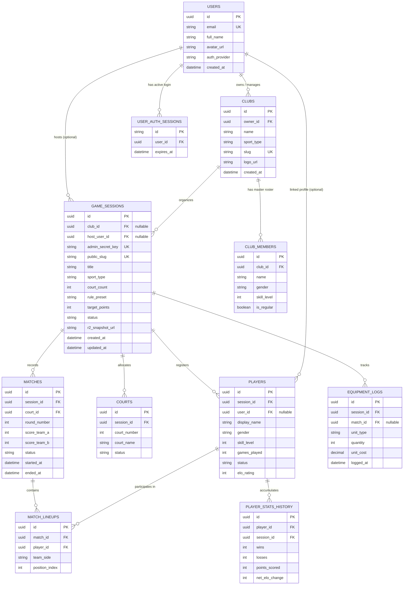

# Entity Relationship Diagram (ERD) & Database Specification — ClubCourt

**Nama Dokumen:** ERD.md  
**Dokumen Versi:** 1.0 (Hybrid Guest & Authenticated Model)  
**Database Engine Rekomendasi:** Cloudflare D1 (SQLite Edge) / Supabase (PostgreSQL)  
**Tanggal:** Oktober 2026  

---

## 1. Konsep Hybrid: "Guest Mode (Tanpa Login) vs Registered Host (Dengan Login)"

Untuk memberikan fleksibilitas maksimal:
1. **Opsi Tanpa Login (Guest Host):**
   - Host langsung klik *"Buat Mabar Sekarang"* tanpa daftar akun.
   - Kolom `host_user_id` bernilai `NULL`.
   - Hak edit diamankan dengan `admin_secret_key` (token acak 32 karakter yang ada di URL host).
2. **Opsi Dengan Login (Registered Host):**
   - Host mendaftar dengan Google OAuth / Email Magic Link.
   - Kolom `host_user_id` terhubung ke tabel `users`.
   - **Benefit Member:** Riwayat mabar tersimpan permanen di profil, bisa membuat klub berulang, melacak statistik histori pemain mingguan, dan mengelola banyak sesi di satu dashboard.

---

## 2. Diagram Hubungan Antar Entitas (Mermaid ERD)



---

## 3. Detail Kamus Data & Relasi Tabel

### 3.1 Tabel `users` (Pengguna Terdaftar / Host Akun)
Menyimpan data host yang memilih untuk mendaftar akun agar riwayat mabarnya tersimpan.
```sql
CREATE TABLE users (
    id TEXT PRIMARY KEY,                 -- UUID v4
    email TEXT UNIQUE NOT NULL,
    full_name TEXT NOT NULL,
    avatar_url TEXT,
    phone_number TEXT,
    auth_provider TEXT DEFAULT 'google', -- 'google' | 'email_otp'
    created_at DATETIME DEFAULT CURRENT_TIMESTAMP,
    updated_at DATETIME DEFAULT CURRENT_TIMESTAMP
);
```

### 3.2 Tabel `user_auth_sessions` (Manajemen Login Session)
Digunakan oleh Lucia Auth / Supabase Auth untuk token login browser host.
```sql
CREATE TABLE user_auth_sessions (
    id TEXT PRIMARY KEY,
    user_id TEXT NOT NULL REFERENCES users(id) ON DELETE CASCADE,
    expires_at DATETIME NOT NULL
);
CREATE INDEX idx_auth_sessions_user ON user_auth_sessions(user_id);
```

### 3.3 Tabel `clubs` (Komunitas / Klub Rutin)
Opsional bagi host terdaftar yang mengelola komunitas tetap (misal: "PB Rajawali").
```sql
CREATE TABLE clubs (
    id TEXT PRIMARY KEY,
    owner_id TEXT NOT NULL REFERENCES users(id) ON DELETE CASCADE,
    name TEXT NOT NULL,                  -- "PB Ceria Bintaro"
    sport_type TEXT NOT NULL,            -- 'badminton' | 'tennis' | 'padel'
    slug TEXT UNIQUE NOT NULL,           -- "pb-ceria-bintaro"
    logo_url TEXT,
    created_at DATETIME DEFAULT CURRENT_TIMESTAMP
);
```

### 3.4 Tabel `game_sessions` (Sesi Mabar Aktif / Lampau)
Inti dari setiap sesi main bersama. Mendukung mode **Guest** maupun **Terdaftar**.
```sql
CREATE TABLE game_sessions (
    id TEXT PRIMARY KEY,
    club_id TEXT REFERENCES clubs(id) ON DELETE SET NULL,     -- NULL jika mabar insidental
    host_user_id TEXT REFERENCES users(id) ON DELETE SET NULL,-- NULL jika Host GUEST (tanpa login)
    admin_secret_key TEXT UNIQUE NOT NULL,                    -- Kunci rahasia untuk hak edit jika guest
    public_slug TEXT UNIQUE NOT NULL,                         -- Slug URL publik penonton: "badmin-senin-8x9q"
    title TEXT NOT NULL,                                      -- "Mabar Badminton Rabu Malam"
    sport_type TEXT NOT NULL,                                 -- 'badminton' | 'tennis' | 'padel'
    court_count INTEGER NOT NULL DEFAULT 2,                   -- Jumlah lapangan disewa
    rule_preset TEXT NOT NULL,                                -- 'rally_21' | 'fast_30' | 'americano_32' | 'fast4'
    target_points INTEGER DEFAULT 21,
    status TEXT NOT NULL DEFAULT 'active',                    -- 'active' | 'completed' | 'archived'
    r2_snapshot_url TEXT,                                     -- Backup snapshot JSON di Cloudflare R2
    created_at DATETIME DEFAULT CURRENT_TIMESTAMP,
    updated_at DATETIME DEFAULT CURRENT_TIMESTAMP
);

CREATE INDEX idx_sessions_public_slug ON game_sessions(public_slug);
CREATE INDEX idx_sessions_host_user ON game_sessions(host_user_id);
```

### 3.5 Tabel `players` (Pemain Sesi Mabar)
Menampung pemain mabar (mayoritas adalah **dummy nama** yang di-paste dari WhatsApp, namun bisa ditautkan ke akun jika pemain ingin klaim statistik).
```sql
CREATE TABLE players (
    id TEXT PRIMARY KEY,
    session_id TEXT NOT NULL REFERENCES game_sessions(id) ON DELETE CASCADE,
    user_id TEXT REFERENCES users(id) ON DELETE SET NULL,     -- NULL jika murni nama dummy dari WA
    display_name TEXT NOT NULL,                               -- "Budi", "Hendra (Pro)"
    gender TEXT CHECK (gender IN ('M', 'F')) DEFAULT 'M',
    skill_level INTEGER DEFAULT 2,                            -- 1: Beginner, 2: Intermediate, 3: Pro
    games_played INTEGER DEFAULT 0,                           -- Counter rotasi bermain
    status TEXT DEFAULT 'active',                             -- 'active' | 'paused' | 'departed'
    elo_rating INTEGER DEFAULT 1000,
    created_at DATETIME DEFAULT CURRENT_TIMESTAMP
);

CREATE INDEX idx_players_session ON players(session_id);
```

### 3.6 Tabel `courts` (Lapangan Aktif)
Mewakili lapangan fisik yang sedang dipakai di GOR.
```sql
CREATE TABLE courts (
    id TEXT PRIMARY KEY,
    session_id TEXT NOT NULL REFERENCES game_sessions(id) ON DELETE CASCADE,
    court_number INTEGER NOT NULL,                            -- Lapangan 1, Lapangan 2
    court_name TEXT,                                          -- "Lapangan Karpet Hijau A"
    status TEXT DEFAULT 'available'                           -- 'available' | 'in_match' | 'maintenance'
);
```

### 3.7 Tabel `matches` & `match_lineups` (Pertandingan & Susunan Pemain)
Mencatat pertandingan, skor per lapangan, dan siapa berpasangan dengan siapa.
```sql
CREATE TABLE matches (
    id TEXT PRIMARY KEY,
    session_id TEXT NOT NULL REFERENCES game_sessions(id) ON DELETE CASCADE,
    court_id TEXT NOT NULL REFERENCES courts(id) ON DELETE CASCADE,
    round_number INTEGER NOT NULL,
    score_team_a INTEGER DEFAULT 0,
    score_team_b INTEGER DEFAULT 0,
    status TEXT DEFAULT 'in_progress',                        -- 'queued' | 'in_progress' | 'completed'
    started_at DATETIME DEFAULT CURRENT_TIMESTAMP,
    ended_at DATETIME
);

CREATE TABLE match_lineups (
    id TEXT PRIMARY KEY,
    match_id TEXT NOT NULL REFERENCES matches(id) ON DELETE CASCADE,
    player_id TEXT NOT NULL REFERENCES players(id) ON DELETE CASCADE,
    team_side TEXT CHECK (team_side IN ('A', 'B')) NOT NULL,  -- Tim A vs Tim B
    position_index INTEGER DEFAULT 1                          -- 1: Player 1, 2: Player 2 (Ganda)
);

CREATE INDEX idx_lineups_match ON match_lineups(match_id);
CREATE INDEX idx_lineups_player ON match_lineups(player_id);
```

### 3.8 Tabel `equipment_logs` (Tracker Shuttlecock / Bola)
Mencatat pemakaian bola per sesi atau per pertandingan.
```sql
CREATE TABLE equipment_logs (
    id TEXT PRIMARY KEY,
    session_id TEXT NOT NULL REFERENCES game_sessions(id) ON DELETE CASCADE,
    match_id TEXT REFERENCES matches(id) ON DELETE SET NULL,  -- Terisi jika mode bayar per match
    unit_type TEXT NOT NULL,                                  -- 'shuttlecock' | 'ball_can'
    quantity INTEGER NOT NULL DEFAULT 1,                      -- Jumlah yang dipakai (+1)
    unit_cost DECIMAL(10, 2) DEFAULT 0.00,                   -- Biaya per unit cock/bola
    logged_at DATETIME DEFAULT CURRENT_TIMESTAMP
);
```

### 3.9 Tabel `player_stats_history` (Riwayat Statistik & Spotify-Wrapped)
Digunakan untuk men-generate statistik akhir sesi (*Win/Loss, MVP, Pasangan Duet Maut*).
```sql
CREATE TABLE player_stats_history (
    id TEXT PRIMARY KEY,
    player_id TEXT NOT NULL REFERENCES players(id) ON DELETE CASCADE,
    session_id TEXT NOT NULL REFERENCES game_sessions(id) ON DELETE CASCADE,
    wins INTEGER DEFAULT 0,
    losses INTEGER DEFAULT 0,
    points_scored INTEGER DEFAULT 0,
    net_elo_change INTEGER DEFAULT 0
);
```

---

## 4. Mekanisme Sinkronisasi Database dengan Cloudflare R2

Bagaimana database relasional ini bekerja harmonis dengan Cloudflare R2 tanpa membuat lambat?

1. **Active Session Buffer (R2 + Memory Cache):**
   - Saat mabar sedang berjalan di lapangan, perubahan skor dan rotasi pemain dapat langsung disimpan secara instan ke R2 (`session.json`) agar sangat cepat (latensi < 50ms) dan murah.
2. **Persistence ke DB (Debounced / Batch Flush):**
   - Perubahan penting (pemain baru dimasukkan, match selesai, atau sesi diakhiri) di-sync ke tabel database Cloudflare D1 / Supabase.
3. **Guest Session Claiming:**
   - Jika host awalnya membuat mabar sebagai **Guest**, lalu di akhir mabar ia memutuskan untuk **Login/Daftar Akun**:
   - Sistem cukup mengeksekusi:
     ```sql
     UPDATE game_sessions 
     SET host_user_id = :newly_logged_in_user_id 
     WHERE admin_secret_key = :secret_key_from_browser;
     ```
   - Semua histori mabar yang baru saja selesai langsung masuk ke akun host tersebut secara mulus!
