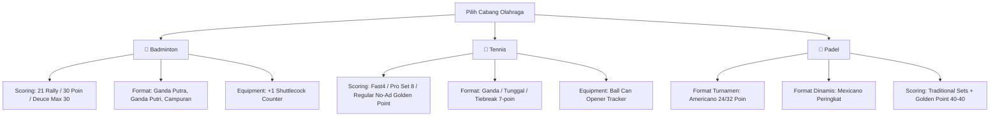

# Product Requirement Document (PRD) — ClubCourt

**Nama Produk:** ClubCourt  
**Tagline:** *Pocket Assistant Host Mabar & Pengatur Rotasi Lapangan (Zero-Friction, No-DB)*  
**Dokumen Versi:** 2.0 (Host-Centric & Flat-File R2 Architecture)  
**Tanggal:** Oktober 2026  
**Status:** In-Development (Phase 1 Initializing for Badminton, Tennis, Padel)  

---

## 1. Executive Summary & Visi Produk

ClubCourt adalah web app **khusus host/ketua mabar** untuk mengotomatisasi penyusunan pemain, rotasi lapangan, dan pencatatan skor tanpa repot.

### Perubahan Paradigma (v2.0):
1. **Zero-Friction untuk Pemain (Tanpa Login / Akun Pemain):**
   - Pemain **tidak perlu registrasi atau login**. Host cukup memasukkan nama dummy (atau paste list nama dari WhatsApp).
   - Fitur Anti-PHP / Payment Escrow yang rumit ditiadakan agar aplikasi tetap ringan, cepat, dan fokus menjadi asisten lapangan.
2. **Arsitektur Flat-File Cloudflare R2 (Tanpa SQL / NoSQL):**
   - Tidak memerlukan database relational atau backend server mahal.
   - Seluruh data sesi disimpan dalam file `session.json` di Cloudflare R2. Host dapat mengedit kapan saja, dan layar display penonton otomatis membaca data terbaru melalui polling ringan.
3. **Multi-Sport Engine (Badminton, Tennis, Padel):**
   - Kustomisasi aturan skor, format turnamen sosial (Americano, Mexicano, Balanced Queue), serta tracker perlengkapan (shuttlecock/bola).
4. **Pojok Edukasi (How to Play & Tips & Tricks):**
   - Panduan interaktif peraturan resmi, etika lapangan, dan strategi bermain untuk masing-masing cabang olahraga.

---

## 2. Target Persona & Use Case

### Host Mabar / Pengurus Komunitas (Single User Primary)
- **Profil:** Ingin mabar berjalan tertib, pembagian lapangan adil, dan semua orang kebagian jatah main tanpa harus memegang kertas/buku catatan.
- **Akses Sistem:**
  - **Host Mode:** Mengakses via link rahasia (contoh: `clubcourt.id/h/sesi-badminton-senin?key=xyz123`) untuk mengontrol rotasi, drag-and-drop pemain, dan input skor.
  - **Spectator / Display Mode:** Membagikan link publik atau scan QR (contoh: `clubcourt.id/g/sesi-badminton-senin`) ke TV GOR atau HP pemain untuk melihat giliran main secara transparan.

---

## 3. Sistem Game & Kustomisasi Tiap Cabang Olahraga

Aplikasi menyediakan kustomisasi format skor, rotasi lapangan, dan kalkulasi unit perlengkapan untuk 3 olahraga utama:



---

### 3.1 🏸 Badminton Engine

#### A. Format Permainan & Aturan Skor
- **Format Default:** Ganda (Doubles - 2 vs 2 per lapangan).
- **Preset Skor:**
  1. *Standar BWF (21 Poin Rally):* Game selesai di 21. Jika deuce 20–20, selisih 2 poin hingga maksimal 30 poin (*sudden death*).
  2. *Social Fast Match (30 Poin Pindah Lapangan di 15):* Format sangat populer di GOR Indonesia untuk mengejar waktu sewa.
  3. *Timer-Based (15 Menit/Match):* Peluit/buzzer berbunyi setelah durasi habis, pasangan dengan poin tertinggi menang.
- **Kategori Pasangan:**
  - Ganda Putra (Men's Doubles)
  - Ganda Putri (Women's Doubles)
  - Ganda Campuran (Mixed Doubles: 1P + 1W vs 1P + 1W)

#### B. Equipment & Cost Tracker: Shuttlecock Counter
- **Mekanisme:** Tombol satu sentuhan `+1 Cock` di sisi atas dashboard host.
- **Fitur Kustomisasi:**
  - Input harga slop (contoh: Rp 140.000 / slop isi 12 = Rp 11.666/cock).
  - Mode Pembagian:
    - *Rata Seluruh Peserta:* Total pemakaian cock dibagi rata ke semua pemain.
    - *Per Match:* Cock dibebankan hanya kepada 4 pemain yang bertanding di laga tersebut.

---

### 3.2 🎾 Tennis Engine

#### A. Format Permainan & Aturan Skor
- **Format:** Ganda (Doubles) atau Tunggal (Singles).
- **Preset Skor:**
  1. *No-Ad System (Sudden Death at 40–40):* Meniadakan sistem Advantage. Saat deuce (40–40), poin penentuan langsung dimainkan (*receiver's choice* / penerima memilih sisi servis).
  2. *Fast4 Tennis:* 4 game untuk memenangkan set. Di 3–3 dimainkan Tiebreak hingga 5 poin.
  3. *Pro Set 8 Games:* Bermain sampai 8 game. Jika 7–7 atau 8–8 dimainkan Super Tiebreak 7 atau 10 poin (sangat pas untuk mabar 2 jam).
  4. *Super Tiebreak Only (10 Poin):* Format singkat saat waktu lapangan tersisa sedikit.

#### B. Equipment Tracker: Tennis Ball Can
- Tracker pembukaan kaleng bola baru (1 kaleng isi 3 atau 4 bola).
- Memisahkan antara bola *fresh* dan bola latihan (*practice balls*).

---

### 3.3 🏓 Padel Engine

Padel adalah olahraga raket paling viral dengan format mabar sosial yang sangat khas.

#### A. Format Turnamen Khusus Padel
1. **Americano Format (Paling Populer):**
   - Setiap pemain bertanding dalam jumlah ronde yang sama.
   - Pasangan dan lawan diacak tiap ronde, memastikan setiap orang pernah berpasangan dengan orang berbeda.
   - Skor tiap match dihitung hingga total poin tertentu (misal: **24 poin** atau **32 poin**). Contoh hasil: 18–14. Poin individu diakumulasikan ke papan klasemen.
2. **Mexicano Format (Dynamic Tier Ladder):**
   - Ronde 1 diacak.
   - Ronde 2 dan seterusnya dipasangkan berdasarkan peringkat klasemen sementara agar pertandingan semakin kompetitif: Pemain peringkat #1 berduet dengan peringkat #3 melawan peringkat #2 dan #4.
3. **Traditional Match (Set & Golden Point):**
   - 1 set ke 6 game dengan *Punto de Oro (Golden Point)* di 40–40.

#### B. Padel Settings
- Setting jumlah lapangan (misal: 1 atau 2 court kaca).
- Pilihan rotasi serve per 4 poin (pada Americano).

---

## 4. Pojok Edukasi: How to Play, Rules, Tips & Tricks

Modul edukasi ini terpasang di halaman web utama dan bisa diakses pemain melalui tab `"📖 Edukasi / Panduan"` untuk memahami cara bermain dan etika lapangan.

---

### 4.1 🏸 Panduan Badminton

#### A. Ringkasan Peraturan Dasar
- **Servis:** Raket harus mengenai kok di bawah pinggang (ketinggian maksimal 1.15 meter dari permukaan lapangan). Arah servis menyilang (diagonal).
- **Garis Lapangan Ganda (Doubles):**
  - *Saat Servis:* Garis samping luar aktif (lapangan lebar), garis belakang dalam aktif (lapangan pendek).
  - *Setelah Servis (Reli Berjalan):* Seluruh garis terluar (lebar dan panjang) aktif.
- **Sistem Poin:** Rally Point 21. Siapa pun yang mematikan kok mendapat 1 poin (tidak perlu pegang servis dulu).

#### B. Posisi Lapangan Ganda (Positioning Strategy)
1. **Posisi Menyerang (Attacking Formation - Depan-Belakang):**
   - Saat tim Anda melakukan smash atau drop shot tajam, satu pemain berdiri di depan net untuk menyergap (*net kill*), dan satu pemain di belakang untuk terus menekan.
2. **Posisi Bertahan (Defensive Formation - Berdampingan Kiri-Kanan):**
   - Saat tim Anda terpaksa mengangkat kok tinggi (*lob*), segera berpindah posisi berdampingan kiri-kanan di area tengah lapangan untuk bersiap menahan smash lawan.

#### C. Tips & Trik Pemula
- **Grip Jangan Seperti Memegang Palu:** Gunakan *Forehand V-Grip* (seperti bersalaman dengan raket) dan *Backhand Thumb-Up Grip* (jempol menekan bidang datar grip).
- **Kembali ke Posisi Tengah (Base):** Setelah memukul kok, jangan menonton kok terbang! Langsung ambil 1 langkah kembali ke titik tengah lapangan Anda.
- **Etika GOR:** Jangan menyeberang melintasi belakang lapangan orang lain saat reli sedang berlangsung; ambil kok yang jatuh di area Anda dan berikan dengan sopan ke penyervis lawan.

---

### 4.2 🎾 Panduan Tennis

#### A. Ringkasan Peraturan Dasar & Sistem Skor
- **Urutan Poin Unik Tennis:**
  - `0` (Love) $\rightarrow$ `15` $\rightarrow$ `30` $\rightarrow$ `40` $\rightarrow$ `Game`.
  - Jika `40–40` (Deuce), dalam mabar sosial umumnya menggunakan aturan **Golden Point (No-Ad)**: 1 poin penentuan langsung tanpa Advantage.
- **Servis:** Harus memantul di dalam kotak servis (*service box*) menyilang. Diberikan kesempatan 2 kali servis (First Serve & Second Serve). Jika bola menyentuh net dan masuk kotak servis, disebut *Let* (servis diulang).

#### B. Posisi Lapangan Ganda Tennis
1. **Satu di Depan (Net Player) & Satu di Belakang (Baselines):**
   - Pemain belakang melakukan servis atau return melintasi net secara konsisten.
   - Pemain depan bersiap melakukan pukulan *Volley* menyergap bola silang lawan (*poaching*).
2. **Komunikasi "Yours!" atau "Mine!":**
   - Bola di area tengah lapangan (*middle shot*) sering memicu tabrakan atau saling membiarkan. Aturan umum: pemain dengan posisi pukulan forehand di tengah yang mengambil bola tersebut.

#### C. Tips & Trik Pemula
- **Split Step:** Lakukan lompatan kecil bertumpu pada ujung jari kaki persis saat raket lawan menyentuh bola. Ini membuat reaksi gerak 2x lebih cepat.
- **Early Preparation:** Putar bahu (*unit turn*) sebelum bola memantul di lapangan Anda, jangan baru mengayun saat bola sudah dekat badan.

---

### 4.3 🏓 Panduan Padel

#### A. Ringkasan Peraturan Dasar
- **Servis Padel Beda dengan Tenis:**
  - Servis dilakukan dengan **memantulkan bola ke lantai 1x terlebih dahulu**, lalu memukul bola **di bawah ketinggian pinggang** (*underhand serve*).
- **Aturan Dinding Kaca (Glass Wall):**
  - Bola dari lawan **harus memantul di lantai lapangan Anda 1 kali** sebelum boleh memantul ke dinding kaca atau pagar kawat.
  - Setelah memantul di lantai dan mengenai kaca belakang/samping, pemain boleh memukul bola tersebut (bahkan boleh memukul bola ke kaca lapangan sendiri agar memantul kembali ke lapangan lawan).
  - *Fault:* Jika bola lawan langsung mengenai kaca atau kawat tanpa memantul ke lantai terlebih dahulu, bola dinyatakan keluar (*out*).

#### B. Pukulan Khas Padel yang Wajib Tahu
1. **Bandeja (Pukulan Nampan):**
   - Pukulan overhead defensif dengan raket datar seperti membawa nampan untuk menjaga posisi di depan net tanpa membuang bola out ke kaca.
2. **Víbora (Pukulan Ular):**
   - Pukulan overhead agresif dengan efek putaran samping (*side-spin* tajam) sehingga saat memantul di kaca belakang lawan, bola jatuh merayap rendah ke lantai.
3. **Chiquita:**
   - Pukulan pelan melengkung ke kaki lawan yang sedang berdiri di depan net untuk memaksa mereka mengangkat bola ke atas.

#### C. Tips & Trik Pemula
- **Sabar, Jangan Buru-Buru Smash:** Padel adalah permainan catur raket. Smash keras yang tidak mematikan justru akan memantul tinggi dari kaca belakang dan menjadi umpan empuk bagi lawan.
- **Gunakan Kaca Sebagai Teman:** Jangan takut saat bola meluncur melewati badan Anda; biarkan bola memantul dari kaca belakang terlebih dahulu, kecepatan bola akan berkurang dan lebih mudah dipukul.

---

## 5. Fitur Produk (Spesifikasi Teknis Sederhana)

### 5.1 Smart Input Nama Dummy (WA Paste 1-Click)
- Host tidak perlu mengetik nama satu per satu.
- Cukup paste daftar chat WA:
  ```text
  1. Hendra (Pro)
  2. Kevin (Inter)
  3. Budi (Beg)
  4. Siti (Beg - Putri)
  ```
- Sistem mendeteksi nama, jenis kelamin, dan level keahlian (Beginner / Intermediate / Pro) secara otomatis.

### 5.2 Algoritma Penyeimbang (Fair Doubles Matchmaking)
- **Aturan:**
  1. Jumlah main paling sedikit $\rightarrow$ Masuk antrean prioritas.
  2. Waktu istirahat paling lama $\rightarrow$ Prioritas masuk lapangan berikutnya.
  3. Total skill seimbang $\rightarrow$ Team A (Skill 3 + 1) vs Team B (Skill 2 + 2).
  4. Tombol *Pause Player* jika ada pemain yang kram atau datang telat.

### 5.3 Live Kiosk TV & Spectator Board
- Link publik yang bersih dan otomatis me-refresh tanpa reload (`session.json` polling).
- Menampilkan lapangan aktif, skor, dan antrean "Siap-siap Selanjutnya".
- Fitur *Text-to-Speech (TTS)* suara bahasa Indonesia untuk pengumuman lapangan via Bluetooth speaker.

---

## 6. Arsitektur Flat-File R2 (Ringkasan Data Model)

Seluruh sesi mabar disimpan sebagai 1 file JSON di Cloudflare R2: `games/{sessionId}/session.json`.

```json
{
  "sessionId": "badmin-2026-10-20-xyz",
  "sport": "badminton",
  "courtCount": 2,
  "scoringConfig": {
    "mode": "rally_21",
    "targetPoints": 21,
    "deuceLimit": 30
  },
  "equipment": {
    "cockCounter": 5,
    "pricePerUnit": 12000
  },
  "players": [
    { "id": "p1", "name": "Hendra", "gender": "M", "skill": 3, "gamesPlayed": 2, "status": "active" },
    { "id": "p2", "name": "Budi", "gender": "M", "skill": 1, "gamesPlayed": 2, "status": "active" }
  ],
  "matches": [
    {
      "id": "m1",
      "courtNumber": 1,
      "teamA": ["p1", "p2"],
      "teamB": ["p3", "p4"],
      "scoreA": 21,
      "scoreB": 18,
      "status": "completed"
    }
  ]
}
```

Host hanya membutuhkan browser untuk membuka aplikasi, mengatur permainan, dan menyimpan state langsung ke Cloudflare R2 tanpa database SQL.
